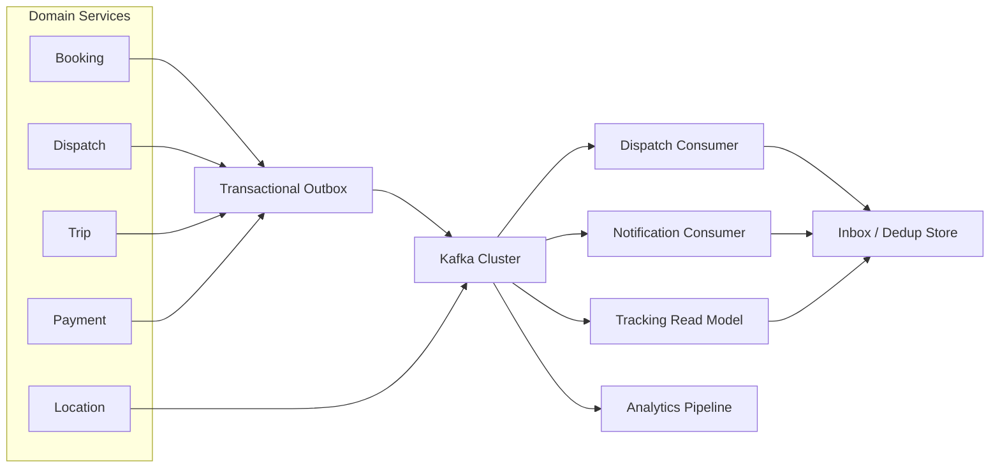
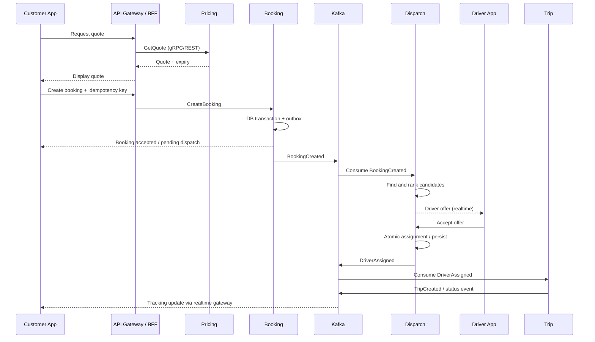
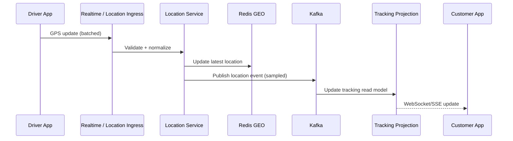
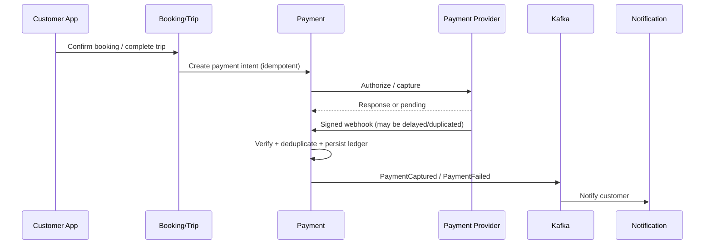
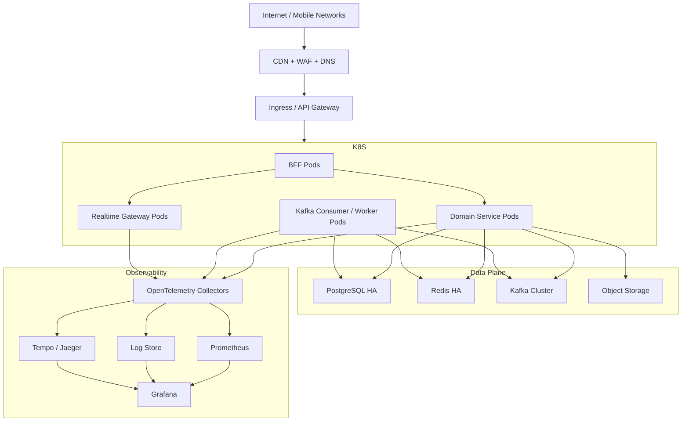

# Tới Nơi — Đề xuất kiến trúc tổng thể ứng dụng

> **Phiên bản:** 1.0  
> **Phạm vi:** Ride-hailing (đặt xe) và Delivery (giao hàng)  
> **Kiến trúc chủ đạo:** Microservices, Event-driven Architecture, Apache Kafka, REST, gRPC  
> **Ứng dụng khách:** iOS Native (Swift), Android Native (Kotlin), Driver/Delivery Partner apps, Public Website, Admin Portal

---

## 1. Mục tiêu và nguyên tắc kiến trúc

Tới Nơi là nền tảng kết nối khách hàng với tài xế/đối tác giao hàng, hỗ trợ đặt chuyến, giao/nhận hàng, định giá, điều phối, thanh toán, theo dõi thời gian thực và vận hành.

Kiến trúc cần đáp ứng:

- **Scale độc lập:** các miền có tải khác nhau (Location, Dispatch, Tracking, Order, Payment) được mở rộng riêng.
- **Độ tin cậy:** không mất đơn, không tạo giao dịch trùng, xử lý được retry, timeout và lỗi phụ thuộc bên ngoài.
- **Realtime:** cập nhật vị trí, trạng thái chuyến/đơn và thông báo nhanh.
- **Consistency có chủ đích:** dùng transaction trong service sở hữu dữ liệu; dùng event-driven/Saga cho quy trình xuyên service.
- **Bảo mật:** xác thực, phân quyền theo vai trò, bảo vệ dữ liệu cá nhân và thông tin thanh toán.
- **Quan sát được:** log, metric, trace và audit xuyên suốt từ mobile đến backend.
- **Testability:** mỗi service có hợp đồng API/event rõ ràng, môi trường test và khả năng mô phỏng dependency.

### 1.1 Nguyên tắc quan trọng

1. Mỗi microservice sở hữu dữ liệu và schema của mình; không truy cập trực tiếp database của service khác.
2. Không dùng Kafka thay cho request/response đồng bộ. Dùng REST/gRPC cho truy vấn hoặc thao tác cần phản hồi ngay; Kafka cho sự kiện và xử lý bất đồng bộ.
3. Không để client gọi trực tiếp hàng loạt microservice. Client đi qua API Gateway/BFF.
4. Các thao tác có thể retry phải được thiết kế idempotent.
5. Không giả định Kafka cung cấp exactly-once end-to-end cho toàn bộ business flow. Thiết kế theo hướng at-least-once + idempotent consumer + transactional outbox/inbox.
6. Không đưa logic nghiệp vụ quan trọng vào API Gateway.
7. Tránh tách service quá nhỏ ở giai đoạn đầu; phân chia theo bounded context và ownership dữ liệu.

---

## 2. Bức tranh kiến trúc tổng thể

```mermaid
flowchart TB
    subgraph Clients["Kênh người dùng"]
        IOS["Customer iOS<br/>Swift"]
        AND["Customer Android<br/>Kotlin"]
        DRIOS["Driver iOS<br/>Swift"]
        DRAND["Driver Android<br/>Kotlin"]
        WEB["Public Website<br/>Giới thiệu / Tra cứu mã đơn"]
        ADMIN["Admin & Operations Portal"]
    end

    subgraph Edge["Edge & Access Layer"]
        CDN["CDN / WAF / DDoS Protection"]
        LB["Load Balancer"]
        APIGW["API Gateway"]
        CBFF["Customer BFF"]
        DBFF["Driver BFF"]
        ABFF["Admin BFF"]
        WBFF["Public Web BFF"]
        AUTH["Identity Provider<br/>OAuth2 / OIDC"]
    end

    subgraph Services["Domain Microservices"]
        USER["Customer & Profile"]
        DRIVER["Driver / Partner"]
        CATALOG["Service Catalog"]
        QUOTE["Pricing & Quote"]
        BOOK["Booking / Order"]
        DISPATCH["Matching & Dispatch"]
        TRIP["Trip / Delivery Lifecycle"]
        LOCATION["Location & Tracking"]
        PAYMENT["Payment & Wallet"]
        PROMO["Promotion"]
        NOTI["Notification"]
        RATING["Rating & Review"]
        SUPPORT["Support / Refund / Dispute"]
        SEARCH["Public Tracking Query"]
    end

    subgraph Async["Event Backbone"]
        KAFKA["Apache Kafka"]
        SCHEMA["Schema Registry"]
        CONNECT["Kafka Connect / CDC"]
    end

    subgraph Data["Data & Cache"]
        PG["Service-owned PostgreSQL clusters"]
        REDIS["Redis Cluster"]
        TS["Time-series / Location store"]
        OBJ["Object Storage"]
        DW["Analytics Warehouse / Lake"]
        ES["Search Index (optional)"]
    end

    subgraph External["External Providers"]
        MAP["Maps / Routing / Geocoding"]
        PAY["Payment Providers"]
        SMS["SMS / Email / Push"]
        KYC["KYC / Identity Verification"]
    end

    subgraph Platform["Platform & Operations"]
        OBS["OpenTelemetry<br/>Metrics / Logs / Traces"]
        SEC["Secrets / KMS / Vault"]
        CI["CI/CD & Container Registry"]
        K8S["Kubernetes / Service Mesh"]
    end

    IOS --> CDN
    AND --> CDN
    DRIOS --> CDN
    DRAND --> CDN
    WEB --> CDN
    ADMIN --> CDN
    CDN --> LB --> APIGW
    APIGW --> CBFF
    APIGW --> DBFF
    APIGW --> ABFF
    APIGW --> WBFF
    APIGW --> AUTH

    CBFF --> USER
    CBFF --> CATALOG
    CBFF --> QUOTE
    CBFF --> BOOK
    DBFF --> DRIVER
    DBFF --> DISPATCH
    DBFF --> TRIP
    DBFF --> LOCATION
    ABFF --> SUPPORT
    ABFF --> BOOK
    ABFF --> PAYMENT
    WBFF --> SEARCH

    USER --> KAFKA
    DRIVER --> KAFKA
    QUOTE --> KAFKA
    BOOK --> KAFKA
    DISPATCH --> KAFKA
    TRIP --> KAFKA
    LOCATION --> KAFKA
    PAYMENT --> KAFKA
    PROMO --> KAFKA
    KAFKA --> NOTI
    KAFKA --> RATING
    KAFKA --> SUPPORT
    KAFKA --> DW

    Services --> PG
    Services --> REDIS
    LOCATION --> TS
    Services --> OBJ
    Services --> MAP
    PAYMENT --> PAY
    NOTI --> SMS
    DRIVER --> KYC
    KAFKA --> SCHEMA
    KAFKA --> CONNECT

    Services --> OBS
    KAFKA --> OBS
    K8S --> CI
    Services --> SEC
```

> Sơ đồ thể hiện các nhóm thành phần và luồng chính, không hàm ý mọi service đều truy cập mọi loại datastore. Mỗi service chỉ dùng datastore phù hợp và do chính service sở hữu.

---

## 3. Phân lớp hệ thống

### 3.1 Client applications

| Client | Công nghệ | Đối tượng | Trách nhiệm chính |
|---|---|---|---|
| Customer iOS | Swift, SwiftUI/UIKit | Khách hàng | Đặt xe/đơn giao hàng, thanh toán, theo dõi, lịch sử, đánh giá |
| Customer Android | Kotlin, Jetpack Compose/View | Khách hàng | Tương tự iOS |
| Driver iOS | Swift | Tài xế/đối tác | Online/offline, nhận/từ chối cuốc, dẫn đường, cập nhật trạng thái |
| Driver Android | Kotlin | Tài xế/đối tác | Tương tự Driver iOS |
| Public Website | SSR/SSG framework | Người dùng công khai | Giới thiệu dịch vụ, FAQ, hỗ trợ, tra cứu mã đơn |
| Admin Portal | Web SPA | CS, điều phối, tài chính, quản trị | Vận hành, tra cứu, xử lý ngoại lệ, cấu hình và báo cáo |

**Khuyến nghị:** Customer App và Driver App nên là hai sản phẩm riêng. Quyền, vòng đời sử dụng, yêu cầu chạy nền, UX và chính sách bảo mật khác nhau đáng kể. Có thể chia sẻ design system, SDK nội bộ và một số thư viện nghiệp vụ, nhưng không nên ép thành một ứng dụng nhiều vai trò nếu không có lý do sản phẩm rõ ràng.

### 3.2 Edge layer: CDN, WAF, Load Balancer, API Gateway

- **CDN:** phân phối static assets của website, ảnh và nội dung công khai.
- **WAF/DDoS protection:** chặn bot, request bất thường, các mẫu tấn công phổ biến.
- **Load Balancer:** phân phối traffic đến ingress/API Gateway.
- **API Gateway:** TLS termination (nếu phù hợp), routing, rate limit, request size limit, authentication enforcement, API version routing và access log.
- **BFF (Backend for Frontend):** tối ưu API theo từng client:
  - Customer BFF.
  - Driver BFF.
  - Admin BFF.
  - Public Web BFF.

BFF có thể là một deployment riêng theo nhóm client, nhưng không nhất thiết là một microservice nghiệp vụ. Tránh để BFF trở thành nơi chứa business rules hoặc orchestration phức tạp.

### 3.3 Giao tiếp đồng bộ và bất đồng bộ

| Nhu cầu | Cơ chế đề xuất | Ví dụ |
|---|---|---|
| Client gọi backend | HTTPS REST/JSON | Tạo booking, lấy lịch sử |
| Service-to-service cần phản hồi ngay | gRPC/Protobuf | Quote gọi Pricing, Dispatch hỏi Driver Availability |
| Phát sự kiện nghiệp vụ | Kafka | BookingCreated, DriverAssigned |
| Xử lý nền | Kafka consumer | Gửi notification, analytics, cập nhật read model |
| Realtime đến app | WebSocket hoặc SSE qua Realtime Gateway | Vị trí tài xế, trạng thái chuyến |
| Push khi app nền/đóng | APNs / FCM | Driver được phân cuốc, trạng thái đơn |

**Quy tắc lựa chọn:**
- REST phù hợp với public API, mobile/web và tích hợp đối tác.
- gRPC phù hợp với giao tiếp nội bộ có schema chặt, latency thấp, streaming hoặc traffic cao.
- Kafka phù hợp với event propagation, buffering, fan-out và xử lý bất đồng bộ.
- Không dùng Kafka request-reply cho mọi lời gọi đồng bộ; mô hình này làm tăng độ phức tạp timeout, correlation và vận hành.

---

## 4. Phân rã Domain Microservices

Phân chia dưới đây là logical service boundary. Ở giai đoạn MVP có thể deploy một số service cùng một application/module rồi tách dần khi tải, ownership hoặc tốc độ phát triển yêu cầu.

### 4.1 Identity & Access Management

| Service / component | Trách nhiệm |
|---|---|
| Identity Provider | Đăng nhập, access token, refresh token, OAuth2/OIDC |
| Customer Profile | Hồ sơ, địa chỉ thường dùng, thiết lập người dùng |
| Driver/Partner Profile | Hồ sơ tài xế, phương tiện, giấy tờ, trạng thái xét duyệt |
| Authorization Policy | Role/permission, policy theo resource và phạm vi dữ liệu |

**Lưu ý:** Có thể dùng một IdP tập trung nhưng profile khách hàng và tài xế vẫn thuộc domain service riêng. Token nên chứa subject, role/scope và các claim tối thiểu; không nhồi dữ liệu hồ sơ thay đổi thường xuyên vào token.

### 4.2 Service Catalog

Quản lý loại dịch vụ và thuộc tính:
- Loại xe, loại giao hàng.
- Khu vực hoạt động.
- Quy tắc kích thước/khối lượng hàng.
- Các tuỳ chọn dịch vụ.
- Cấu hình hiển thị theo vùng.

### 4.3 Pricing & Quote Service

Trách nhiệm:
- Tính giá ước tính và giá cuối cùng theo policy.
- Tính khoảng cách/thời gian dự kiến từ Map/Routing provider hoặc routing engine.
- Áp dụng hệ số khu vực, thời điểm, loại dịch vụ, phụ phí.
- Tạo quote có thời hạn hiệu lực.
- Lưu snapshot quy tắc và dữ liệu đầu vào dùng để tính giá.

**Thiết kế quan trọng:**
- Quote nên có `quote_id`, `expires_at`, `pricing_version` và breakdown.
- Khi booking được xác nhận, lưu snapshot quote để tránh giá thay đổi hồi tố.
- Không gọi Map provider quá nhiều lần trong hot path; cache hợp lý và có timeout/fallback.
- Tách giá ước tính, giá được chấp nhận và giá quyết toán cuối cùng.

### 4.4 Booking / Order Service

Đây là nguồn sự thật (system of record) cho booking/đơn hàng:
- Tạo, xác nhận, huỷ booking.
- Quản lý thông tin điểm đón/điểm giao.
- Quản lý trạng thái nghiệp vụ cấp booking/order.
- Lưu idempotency key và request fingerprint.
- Phát `BookingCreated`, `BookingCancelled`...
- Quản lý version để chống cập nhật trạng thái cũ ghi đè trạng thái mới.

Nên cân nhắc tách `Ride Booking` và `Delivery Order` nếu hai domain phát triển khác nhau đáng kể. Ban đầu có thể dùng chung Order Core nhưng mô hình hoá lifecycle riêng, tránh một state machine quá nhiều nhánh.

### 4.5 Matching & Dispatch Service

Trách nhiệm:
- Tìm tài xế/đối tác phù hợp theo vị trí, loại dịch vụ, trạng thái, năng lực và policy.
- Xếp hạng ứng viên.
- Gửi offer và quản lý thời gian phản hồi.
- Xử lý accept/reject/timeout.
- Điều phối lại khi tài xế từ chối hoặc mất kết nối.

Đây là domain có yêu cầu latency và concurrency cao. Cần thiết kế rõ:
- Một booking chỉ có một assignment hợp lệ tại một thời điểm.
- Atomic claim/lease hoặc optimistic concurrency để tránh hai tài xế cùng nhận một đơn.
- Offer có TTL và `offer_id`.
- Idempotency cho thao tác accept/reject.
- Có cơ chế chống gửi offer lặp và xử lý late response.
- Redis có thể hỗ trợ candidate lookup/lease, nhưng trạng thái assignment chính thức cần được persist vào datastore của Dispatch/Trip theo transaction phù hợp.

### 4.6 Driver Availability Service

Quản lý trạng thái sẵn sàng:
- Online/offline.
- Busy/available.
- Loại dịch vụ được phép nhận.
- Khu vực và ca hoạt động.
- Trạng thái kết nối/heartbeat.

Có thể gộp vào Driver Service ban đầu. Khi tải realtime lớn, tách Availability để scale và tối ưu riêng.

### 4.7 Trip / Delivery Lifecycle Service

Quản lý vòng đời sau khi được gán tài xế:
- Driver assigned.
- Driver arrived.
- Pickup started/completed.
- In transit.
- Delivered / Trip completed.
- Cancelled / Failed.

Dùng state machine có transition hợp lệ, actor được phép thực hiện và điều kiện chuyển trạng thái. Không cho client tự gửi một trạng thái bất kỳ.

### 4.8 Location & Tracking Service

Trách nhiệm:
- Nhận GPS update từ Driver App.
- Validate timestamp, accuracy, tốc độ và tần suất.
- Lưu vị trí mới nhất và lịch sử cần thiết.
- Cung cấp vị trí cho Dispatch và Customer Tracking.
- Phát event vị trí hoặc cập nhật realtime channel.

**Khuyến nghị:**
- Không ghi mọi GPS point vào PostgreSQL transactional database nếu tần suất và quy mô lớn.
- Redis GEO hoặc geospatial index phù hợp cho vị trí mới nhất/candidate search.
- Time-series hoặc object storage/data lake phù hợp cho lịch sử dài hạn và phân tích.
- Áp dụng sampling, retention, partitioning và chính sách quyền riêng tư.
- Tách luồng telemetry vị trí khỏi các event nghiệp vụ quan trọng; không để GPS traffic làm nghẽn topic booking/payment.

### 4.9 Payment & Wallet Service

Trách nhiệm:
- Payment intent/authorization/capture.
- Ví, ledger, số dư và giao dịch.
- Refund, reversal và đối soát.
- Webhook từ cổng thanh toán.
- Quản lý trạng thái giao dịch và idempotency.

**Khuyến nghị mạnh:**
- Ledger bất biến (append-only) cho các bút toán tài chính; không chỉ lưu một cột balance có thể ghi đè.
- Lưu external transaction reference và idempotency key.
- Verify chữ ký webhook, chống replay và xử lý webhook đến trễ/trùng.
- Không lưu PAN/CVV; dùng tokenization/hosted payment page hoặc SDK của PSP theo phạm vi tuân thủ.
- Không coi callback từ client là bằng chứng thanh toán thành công.

### 4.10 Promotion Service

- Mã giảm giá, campaign, eligibility.
- Giới hạn lượt sử dụng, ngân sách, quota.
- Reserve/redeem/release promotion.
- Chống áp dụng đồng thời vượt quota bằng atomic operation/locking phù hợp.

### 4.11 Notification Service

- Push notification qua APNs/FCM.
- SMS/email qua provider.
- Template, locale, preference và retry policy.
- Consumer từ Kafka để gửi thông báo theo event.
- Deduplication theo notification key; dead-letter queue cho lỗi không thể xử lý.

Notification không nên nằm trong transaction đồng bộ tạo booking. Booking thành công không nên phụ thuộc provider SMS/Push có đang hoạt động hay không.

### 4.12 Rating & Review Service

- Rating sau chuyến/đơn hoàn tất.
- Review, moderation, report.
- Chống gửi đánh giá trùng.
- Aggregate rating được cập nhật bất đồng bộ.

### 4.13 Support, Refund & Dispute Service

- Ticket hỗ trợ.
- Khiếu nại chuyến/đơn.
- Quy trình hoàn tiền và bồi hoàn.
- Evidence/attachment.
- SLA, assignment cho nhân viên hỗ trợ.
- Audit trail mọi thao tác admin.

### 4.14 Public Tracking Query Service

Dành cho website tra cứu mã đơn:
- Nhận tracking code và xác minh bổ sung khi cần.
- Trả về read model tối giản: trạng thái, mốc thời gian, thông tin giao nhận được phép công khai.
- Không truy vấn trực tiếp database của Order/Trip.
- Không trả số điện thoại, địa chỉ đầy đủ, thông tin thanh toán hoặc vị trí chính xác của tài xế nếu không cần thiết.

Tracking code phải đủ entropy, không tuần tự dễ đoán. Nên dùng token ngẫu nhiên khó dò, rate limit, bot protection và có thể yêu cầu OTP/điện thoại xác minh cho thông tin nhạy cảm.

---

## 5. Phân loại dữ liệu và quyền sở hữu

| Domain | Data owner | Datastore gợi ý | Ghi chú |
|---|---|---|---|
| Identity/Profile | Identity/Profile services | PostgreSQL | PII, mã hoá và kiểm soát truy cập |
| Booking/Order | Booking service | PostgreSQL | Transactional source of truth |
| Dispatch/Assignment | Dispatch service | PostgreSQL + Redis | Redis cho lease/candidate cache |
| Driver Availability | Availability service | Redis + PostgreSQL | Redis cho trạng thái nóng, DB cho dữ liệu bền vững |
| Location | Tracking service | Redis GEO + time-series/object storage | Tối ưu ghi và truy vấn không gian |
| Payment/Wallet | Payment service | PostgreSQL | Ledger và đối soát |
| Promotion | Promotion service | PostgreSQL + Redis | Quota/atomic counter |
| Notification | Notification service | PostgreSQL hoặc datastore phù hợp | Delivery status, template |
| Search/Tracking view | Query service | Read model / Redis / Search index | Có thể rebuild từ events |
| Analytics | Data platform | Warehouse/Lake | Không chạy báo cáo nặng trên OLTP |

### 5.1 Database per service có cần mỗi service một cụm DB?

Không nhất thiết. `Database per service` là quyền sở hữu logic và ranh giới truy cập, không bắt buộc mỗi service có một cluster vật lý riêng.

Giai đoạn đầu có thể dùng:
- Một PostgreSQL cluster dùng chung hạ tầng.
- Mỗi service có database/schema và credential riêng.
- Migration và quyền truy cập độc lập.
- Không cho service A query schema của service B.

Khi tải hoặc yêu cầu cách ly tăng, tách cluster cho các domain trọng yếu như Payment, Booking, Location/Tracking.

---

## 6. Kafka Event Architecture

### 6.1 Vai trò Kafka

Kafka là event backbone cho:
- Domain events giữa các bounded context.
- Fan-out cho Notification, Analytics, Search/Read Model.
- Buffering khi consumer chậm.
- Replay/rebuild read model.
- Streaming aggregation và event processing.

Kafka không phải database nghiệp vụ chính và không thay thế transaction của từng service.

### 6.2 Sơ đồ event flow

### 6.3 Transactional Outbox và Inbox

**Vấn đề dual-write:** service vừa commit database vừa publish Kafka. Nếu DB commit thành công nhưng publish thất bại (hoặc ngược lại), dữ liệu và event lệch nhau.

**Giải pháp đề xuất:**
1. Trong cùng transaction DB, ghi business record và một record vào bảng `outbox`.
2. Outbox relay/CDC publish record sang Kafka.
3. Consumer xử lý event và ghi `event_id` vào inbox/dedup table trong cùng transaction với cập nhật nghiệp vụ.
4. Nếu event bị gửi lại, consumer nhận ra đã xử lý và bỏ qua.

Ví dụ outbox fields:
- `event_id`
- `aggregate_type`
- `aggregate_id`
- `event_type`
- `aggregate_version`
- `occurred_at`
- `payload`
- `published_at`

### 6.4 Topic design tham khảo

Tên topic theo convention: `<domain>.<entity>.<event>.v1` hoặc `<domain>.<event>.v1`.

| Topic | Key đề xuất | Event mẫu |
|---|---|---|
| `booking.events.v1` | `booking_id` | BookingCreated, BookingCancelled |
| `dispatch.events.v1` | `booking_id` | DriverOfferCreated, DriverAssigned |
| `driver.availability.v1` | `driver_id` | DriverOnline, DriverOffline |
| `trip.events.v1` | `trip_id` | DriverArrived, TripStarted, TripCompleted |
| `delivery.events.v1` | `order_id` | PackagePickedUp, DeliveryCompleted |
| `payment.events.v1` | `payment_id` hoặc `order_id` | PaymentAuthorized, PaymentCaptured, RefundCompleted |
| `location.updates.v1` | `driver_id` | DriverLocationUpdated |
| `notification.commands.v1` | `recipient_id` | SendPush, SendSMS |
| `tracking.projection.v1` | `tracking_id` | TrackingStatusChanged |

Không nên gom toàn bộ event vào một topic khổng lồ. Cũng không nên tạo topic cho từng event nhỏ một cách máy móc. Chọn topic theo nhu cầu partitioning, retention, ACL, throughput và consumer ownership.

### 6.5 Partitioning và ordering

- Chọn key theo aggregate cần giữ thứ tự: `booking_id`, `order_id`, `trip_id`, `payment_id`.
- Kafka chỉ bảo đảm thứ tự trong một partition, không bảo đảm thứ tự toàn cluster.
- Tăng partition có thể thay đổi mapping key-partition; cần cân nhắc với hệ thống phụ thuộc thứ tự.
- Tránh key có skew quá lớn gây hot partition.
- Không dùng `driver_id` làm key cho mọi event nếu một số tài xế tạo lượng event vượt trội.

### 6.6 Schema và compatibility

- Dùng Avro hoặc Protobuf với Schema Registry.
- Quy định compatibility mode (thường backward compatibility cho event evolution).
- Không đổi ý nghĩa field hiện có.
- Field mới nên có default/optional phù hợp.
- Version event khi có thay đổi không tương thích.
- Event cần có `event_id`, `event_type`, `occurred_at`, `producer`, `correlation_id`, `trace_id`, `schema_version` và aggregate identifier.

### 6.7 Retry và Dead Letter

- Phân loại lỗi transient và permanent.
- Retry có exponential backoff + jitter.
- Không retry vô hạn trong cùng consumer loop.
- Dùng retry topic hoặc scheduler phù hợp; DLQ cho event cần can thiệp.
- Có dashboard theo dõi consumer lag, retry rate, DLQ size và tuổi event.
- Có quy trình replay DLQ an toàn, có kiểm soát và audit.

---

## 7. gRPC Architecture

### 7.1 Nơi nên dùng gRPC

| Caller | Callee | Lý do |
|---|---|---|
| Booking | Pricing | Cần quote/price phản hồi ngay |
| Dispatch | Driver Availability | Tra cứu trạng thái ứng viên |
| Dispatch | Routing Adapter | Ước lượng ETA/distance |
| Trip | Payment | Thực hiện thao tác cần kết quả đồng bộ ở một số bước |
| Admin BFF | Internal Query Services | API nội bộ có schema chặt |

Các lệnh nghiệp vụ quan trọng vẫn cần idempotency và timeout rõ ràng, kể cả khi dùng gRPC.

### 7.2 Quy ước gRPC

- Dùng Protobuf, quản lý `.proto` như API contract.
- Deadline bắt buộc; không để call vô hạn.
- Retry chỉ với operation an toàn và mã lỗi phù hợp.
- Propagate trace context và correlation ID.
- Health checking và graceful shutdown.
- Phân biệt status code: `INVALID_ARGUMENT`, `NOT_FOUND`, `ALREADY_EXISTS`, `FAILED_PRECONDITION`, `RESOURCE_EXHAUSTED`, `UNAVAILABLE`, `DEADLINE_EXCEEDED`.
- Dùng mTLS giữa service nếu triển khai service mesh hoặc PKI nội bộ.
- Có compatibility policy cho field và RPC method.

### 7.3 gRPC streaming và mobile

Không mặc định dùng gRPC trực tiếp từ mobile cho toàn bộ API. Với môi trường mạng di động, proxy và load balancer, REST/JSON thường dễ tương thích hơn. Realtime mobile có thể dùng WebSocket/SSE hoặc push gateway; gRPC streaming phù hợp hơn cho một số luồng service-to-service.

---

## 8. Các luồng nghiệp vụ end-to-end

### 8.1 Đặt xe/giao hàng và điều phối tài xế

**Các điểm cần thiết kế kỹ:**
- Booking API idempotent theo customer + key.
- Quote hết hạn phải được kiểm tra khi tạo booking.
- Dispatch offer có TTL.
- Accept offer phải atomic để chỉ một driver thắng.
- Nếu tài xế mất kết nối sau khi nhận offer, cần timeout/re-dispatch.
- Booking có thể ở trạng thái `PENDING_DISPATCH` trong khi tìm tài xế; không đồng nghĩa request HTTP phải chờ đến khi tìm được tài xế.

### 8.2 Cập nhật vị trí và tracking

Nên có hai luồng:
- **Hot path:** vị trí mới nhất để Dispatch và Customer Tracking.
- **Historical path:** dữ liệu lịch sử phục vụ replay, phân tích, điều tra và tối ưu vận hành.

Không nhất thiết phát mọi GPS point vào Kafka với cùng tần suất. Có thể sampling, batching hoặc chỉ phát khi vượt ngưỡng khoảng cách/thời gian.

### 8.3 Thanh toán

Payment có thể ở trạng thái `PENDING` cho đến khi nhận kết quả chắc chắn từ provider. Thiết kế đối soát định kỳ để xử lý trường hợp webhook bị mất hoặc provider trả kết quả không đồng nhất.

### 8.4 Public website tra cứu mã đơn

1. Người dùng nhập tracking code.
2. Public Web BFF gọi Public Tracking Query Service.
3. Service kiểm tra format, rate limit và anti-enumeration.
4. Query read model được cập nhật từ event.
5. Trả về trạng thái và timeline đã được lọc dữ liệu nhạy cảm.
6. Nếu cần xem chi tiết, yêu cầu OTP hoặc yếu tố xác minh bổ sung.

Không nên cho website public gọi trực tiếp Order Service bằng mã đơn tuần tự.

---

## 9. State machine và consistency

### 9.1 Tách state theo domain

Không nên có một trạng thái duy nhất bao trùm mọi thứ. Ví dụ:

- Booking state: `CREATED`, `PENDING_DISPATCH`, `ASSIGNED`, `CANCELLED`, `COMPLETED`.
- Dispatch state: `SEARCHING`, `OFFERED`, `ASSIGNED`, `EXPIRED`, `FAILED`.
- Trip state: `DRIVER_EN_ROUTE`, `DRIVER_ARRIVED`, `IN_PROGRESS`, `COMPLETED`, `CANCELLED`.
- Payment state: `INITIATED`, `AUTHORIZED`, `CAPTURED`, `FAILED`, `REFUND_PENDING`, `REFUNDED`.

Tên trạng thái thực tế cần được chuẩn hoá với Product/Operations. Các state machine liên kết bằng event, không cập nhật chéo database.

### 9.2 Saga cho quy trình nhiều service

Ví dụ tạo booking:
1. Booking tạo đơn ở trạng thái chờ điều phối.
2. Dispatch tìm tài xế.
3. Driver được gán.
4. Trip được khởi tạo.
5. Payment intent được tạo khi đến đúng thời điểm nghiệp vụ.

Nếu dispatch thất bại:
- Có thể retry tìm tài xế.
- Nếu hết thời gian, Booking chuyển `UNFULFILLED` hoặc trạng thái tương đương.
- Nếu đã giữ promotion/payment authorization, chạy compensation release/void.

**Chọn orchestration hay choreography:**
- Choreography phù hợp với event đơn giản, ít bước và ít nhánh.
- Orchestration phù hợp với workflow dài, có timeout, compensation và cần theo dõi trạng thái tổng thể.
- Với booking → dispatch → trip → payment/refund, cân nhắc một Workflow/Saga Orchestrator cho các quy trình quan trọng, nhưng tránh tạo orchestrator cho mọi tương tác nhỏ.

---

## 10. Realtime Architecture

Đề xuất một **Realtime Gateway** độc lập:
- Mobile mở WebSocket connection sau khi xác thực.
- Gateway quản lý connection, channel subscription và fan-out.
- Backend publish notification/tracking event qua Kafka hoặc internal pub/sub.
- Gateway gửi đúng event đến đúng user/device/channel.
- Push notification là fallback khi app không foreground.

Các channel ví dụ:
- `customer:{customer_id}:booking:{booking_id}`
- `driver:{driver_id}:offers`
- `driver:{driver_id}:trip:{trip_id}`

Phải kiểm tra quyền subscribe ở server. Không cho client tự đoán channel ID rồi nghe dữ liệu người khác.

**Tách hai loại message:**
- Durable business event: booking assigned, payment captured, delivery completed — phải có khả năng truy vết và khôi phục.
- Ephemeral telemetry: vị trí mới nhất, typing/presence — có thể coalesce/drop theo policy khi quá tải.

---

## 11. Website, Admin Portal và phân quyền

### 11.1 Public Website

Các module:
- Trang chủ, giới thiệu dịch vụ.
- Bảng giá/chính sách.
- FAQ, hướng dẫn.
- Liên hệ/hỗ trợ.
- Tra cứu đơn/chuyến bằng tracking code.
- SEO, responsive và accessibility.

Dữ liệu public nên được phục vụ từ CMS hoặc Public Web BFF/read model. Không expose API nội bộ.

### 11.2 Admin & Operations Portal

Các module đề xuất:
- Dashboard vận hành: booking active, tài xế online, đơn quá SLA, lỗi tích hợp.
- Booking/Trip/Delivery search.
- Live map và trạng thái điều phối.
- Driver/Partner onboarding, KYC và quản lý phương tiện.
- Pricing/Promotion configuration.
- Payment, wallet, refund, reconciliation.
- Support ticket, dispute.
- Notification templates.
- User/role/permission.
- Audit log và báo cáo.

**Phân quyền theo vai trò và phạm vi:**
- Customer Support: xem thông tin cần thiết, tạo ticket, không tự ý sửa ledger.
- Dispatcher: xem bản đồ, điều phối lại theo policy.
- Finance: xem giao dịch, đối soát, refund theo approval workflow.
- Admin: quản trị cấu hình và quyền, có MFA.
- Super Admin: số lượng rất hạn chế, thao tác nhạy cảm cần approval/audit.

Các thao tác nhạy cảm như refund, điều chỉnh giá, khoá tài khoản, thay đổi quyền cần reason code, audit log và có thể yêu cầu maker-checker (người tạo và người duyệt khác nhau).

---

## 12. Mobile architecture

### 12.1 iOS — Swift

Gợi ý phân lớp:
- Presentation: SwiftUI/UIKit, ViewModel.
- Domain: Use Cases, Entities, Repository protocols.
- Data: API clients, DTO, Repository implementations, local persistence.
- Platform: Core Location, APNs, Keychain, background tasks.

Các yêu cầu:
- Keychain cho token/secret.
- Refresh token rotation và revoke.
- Certificate/public key pinning chỉ khi có quy trình vận hành rotation phù hợp; không triển khai pinning cứng thiếu cơ chế cập nhật.
- GPS background mode theo đúng mục đích và chính sách nền tảng.
- Offline queue cho một số thao tác có thể trì hoãn; không tự giả định một hành động nhạy cảm đã thành công khi chưa có server confirmation.
- Deep link/universal link cho tracking và hỗ trợ.

### 12.2 Android — Kotlin

Gợi ý phân lớp:
- Presentation: Jetpack Compose, ViewModel.
- Domain: Use Cases, Entities, Repository interfaces.
- Data: Retrofit/OkHttp hoặc client phù hợp, DTO, Room.
- Platform: Fused Location Provider, FCM, WorkManager, Android Keystore.

Các yêu cầu:
- Bảo vệ token bằng Android Keystore.
- Xử lý background location đúng policy Android/Google Play.
- WorkManager cho tác vụ nền có thể trì hoãn.
- Retry có backoff, network state awareness.
- Không giữ GPS tracking liên tục nếu không có trạng thái công việc hợp lệ.

### 12.3 Mobile API contract

- OpenAPI cho REST và Protobuf cho gRPC nội bộ.
- Sinh client SDK nếu phù hợp; không chia sẻ DTO backend trực tiếp với domain model mobile.
- Versioning và deprecation policy.
- Pagination bằng cursor cho danh sách lớn.
- Idempotency key cho create/cancel/payment-related operations.
- Push payload không chứa dữ liệu nhạy cảm; app fetch chi tiết qua API được bảo vệ.

---

## 13. Security & Privacy

### 13.1 Identity và access

- OAuth2/OIDC; access token thời hạn ngắn, refresh token rotation.
- MFA cho Admin và các thao tác rủi ro.
- RBAC kết hợp ABAC khi cần phân quyền theo vùng, đội vận hành hoặc resource ownership.
- Service identity riêng; không dùng chung credential giữa service.
- mTLS hoặc workload identity cho service-to-service.

### 13.2 Data protection

- TLS mọi kết nối.
- Encryption at rest cho DB, object storage, backup.
- Secrets trong Vault/KMS/Secret Manager, không lưu trong source code hoặc image.
- Mask PII trong log, trace và dashboard.
- Data retention policy cho GPS, audit, support attachments.
- Backup encryption và kiểm thử restore.

### 13.3 Abuse prevention

- Rate limit theo IP, account, device và endpoint.
- Bot protection cho public tracking.
- Chống account takeover, credential stuffing và OTP abuse.
- Replay protection cho webhook.
- Validate webhook signature và timestamp.
- Admin audit trail không thể tuỳ tiện sửa/xoá.

### 13.4 Threat modeling

Nên threat-model tối thiểu các luồng:
- Đăng nhập/OTP và reset credential.
- Tạo booking và áp mã khuyến mãi.
- Driver accept offer.
- GPS spoofing và giả mạo vị trí.
- Payment webhook và refund.
- Public tracking code enumeration.
- Admin impersonation và quyền quá rộng.

---

## 14. Reliability, resilience và performance

| Vấn đề | Biện pháp |
|---|---|
| Service chậm/lỗi | Timeout, bounded retry, circuit breaker, bulkhead |
| Duplicate request | Idempotency key, unique constraint |
| Duplicate Kafka event | Consumer dedup/inbox |
| Event publish thất bại | Transactional outbox |
| Consumer lỗi liên tục | Retry topic, DLQ, alert |
| Race condition nhận cuốc | Atomic claim/lease, optimistic concurrency |
| Event đến sai thứ tự | Aggregate version, state transition validation |
| Redis mất dữ liệu | DB source of truth, rebuild cache |
| Payment webhook trùng | Signature verify + idempotent processing |
| Map/Payment provider outage | Timeout, fallback, degraded mode |
| DB quá tải | Pool limit, query tuning, partitioning, read model |
| Kafka backlog | Consumer scaling, lag alert, backpressure |

### 14.1 SLO gợi ý ban đầu

Các con số sau là mục tiêu khởi tạo để thảo luận, không phải cam kết trước khi có workload test:

| Capability | SLO mục tiêu ban đầu |
|---|---|
| Public API availability | 99.9% theo tháng |
| Booking API latency | p95 dưới 500 ms, không tính thời gian tìm tài xế |
| Quote API latency | p95 dưới 500 ms, phụ thuộc Map provider |
| Realtime status propagation | p95 dưới 2–3 giây |
| Driver location freshness | p95 dưới 5–10 giây khi app online và được phép gửi nền |
| Payment state convergence | Theo SLA của PSP; có reconciliation |
| Recovery | RTO/RPO xác định theo domain criticality |

Cần định nghĩa rõ SLI, cửa sổ đo, loại trừ dependency bên ngoài và error budget.

---

## 15. Observability & Operations

### 15.1 Bộ công cụ tham khảo

- **Metrics:** Prometheus.
- **Dashboard:** Grafana.
- **Logs:** Loki hoặc OpenSearch/ELK.
- **Tracing:** OpenTelemetry + Tempo hoặc Jaeger.
- **Alerting:** Alertmanager hoặc nền tảng tương đương.
- **Profiling:** Pyroscope hoặc công cụ phù hợp runtime.
- **Kafka monitoring:** consumer lag, broker health, under-replicated partitions, request latency.
- **Kubernetes monitoring:** node/pod resource, restart, scheduling, network.

### 15.2 Business metrics cần theo dõi

- Booking creation success rate.
- Time to assign driver.
- Driver acceptance rate.
- Dispatch timeout/reassignment rate.
- Cancellation rate theo actor và reason.
- Trip/delivery completion rate.
- Payment authorization/capture/failure rate.
- Refund volume và reconciliation mismatch.
- GPS freshness và tracking disconnect rate.
- Notification delivery success.
- Support ticket volume và SLA breach.

### 15.3 Correlation

Mỗi request/event nên mang theo:
- `trace_id`
- `correlation_id`
- `request_id`
- `user_id`/`actor_id` (đã kiểm soát PII)
- `booking_id`/`order_id`
- `event_id`

Không dùng PII thô làm label metric vì gây cardinality cao và rủi ro riêng tư.

---

## 16. Hạ tầng triển khai tham khảo

### 16.1 Runtime

- Container hoá bằng Docker.
- Kubernetes cho orchestration nếu đội ngũ có năng lực vận hành.
- Ingress/API Gateway.
- Service mesh (Istio/Linkerd) chỉ khi cần mTLS, traffic policy, telemetry và có khả năng vận hành; không bắt buộc ngay từ đầu.
- GitOps (Argo CD/Flux) cho deployment.
- Terraform/OpenTofu cho infrastructure as code.

### 16.2 Môi trường

Tối thiểu:
- `dev`: phát triển tích hợp.
- `test/qa`: kiểm thử tự động và thủ công.
- `staging`: gần production, dùng để rehearsal.
- `production`: production.

Không dùng chung credentials hoặc dữ liệu PII production trong môi trường test. Dữ liệu test cần synthetic/masked.

### 16.3 Kafka deployment

Production cần:
- Replication factor phù hợp (thường ít nhất 3 khi có đủ broker).
- `min.insync.replicas` và producer `acks=all` theo yêu cầu durability.
- TLS/SASL và ACL theo topic.
- Rack awareness/zone awareness.
- Capacity planning cho throughput, retention và peak traffic.
- Backup/replication hoặc DR strategy cho event quan trọng.
- Theo dõi disk, network, ISR, request latency và consumer lag.

Không chốt số broker/partition chỉ theo cảm tính; phải dựa vào message rate, kích thước payload, retention, consumer count và khả năng phục hồi.

### 16.4 Multi-zone và disaster recovery

- Phân bố workload qua nhiều availability zone nếu nền tảng hỗ trợ.
- PostgreSQL HA, backup PITR và kiểm thử restore.
- Kafka replication/DR theo RPO/RTO.
- Redis HA và xác định rõ dữ liệu nào có thể rebuild.
- Object storage versioning/lifecycle.
- Runbook cho region/zone outage và diễn tập định kỳ.

---

## 17. CI/CD và chất lượng phần mềm

Pipeline cho mỗi service:
1. Lint/static analysis.
2. Unit tests.
3. Component tests với dependency test container.
4. Contract tests (REST/gRPC/Kafka schema).
5. Integration tests.
6. Security scan (SAST, dependency, container, secret scan).
7. Build immutable image và ký artifact.
8. Deploy dev/test.
9. Smoke test.
10. Promote staging/production với approval và progressive delivery.

### 17.1 Testing strategy phù hợp kiến trúc

| Test level/type | Phạm vi ví dụ |
|---|---|
| Unit | Pricing rules, state transition, fee calculation |
| Component | Booking service + PostgreSQL/Redis test instance |
| Contract | Booking ↔ Pricing gRPC; event schema BookingCreated |
| Integration | Outbox relay, Kafka consumer, payment webhook |
| API | REST validation, auth, idempotency, pagination |
| System | Customer đặt chuyến từ đầu đến cuối |
| E2E | Customer App ↔ Driver App ↔ Backend ↔ PSP sandbox |
| Performance | Dispatch peak, GPS ingestion, Kafka throughput |
| Resilience | Kill consumer, broker unavailable, Redis failover |
| Security | IDOR, privilege escalation, tracking enumeration |
| Data consistency | Duplicate/out-of-order event, reconciliation |
| Mobile | Background location, network switching, push/deep link |

### 17.2 Testability hooks

- Correlation ID có thể tra cứu end-to-end.
- Seed/test data API chỉ bật ở non-production.
- Fake adapters cho Map/Payment/SMS.
- Kafka test topic hoặc isolated namespace.
- Clock abstraction để test expiry/timeout.
- Deterministic dispatch mode trong test.
- Có thể replay event trong môi trường cô lập.
- Không tạo backdoor test trong production.

---

## 18. Kiến trúc theo giai đoạn phát triển

Không nên triển khai toàn bộ service ngay từ ngày đầu. Đề xuất tiến hóa theo năng lực sản phẩm và traffic.

### Phase 1 — MVP

Mục tiêu: ra mắt được luồng đặt dịch vụ cốt lõi.

Deployable services gợi ý:
1. Identity/Profile.
2. Driver/Partner.
3. Catalog + Pricing.
4. Booking/Order.
5. Dispatch + Availability.
6. Trip/Delivery.
7. Payment Adapter/Payment.
8. Notification.
9. Location/Tracking.
10. Admin/Public BFF.

Hạ tầng:
- PostgreSQL HA.
- Redis.
- Kafka cluster có capacity phù hợp.
- API Gateway.
- Realtime Gateway.
- Object Storage.
- Observability stack.

Ở MVP, có thể gộp một số bounded context thành deployable lớn hơn, nhưng vẫn giữ module boundary, schema ownership và contract rõ.

### Phase 2 — Scale & operational maturity

- Tách Location Ingestion khỏi Tracking Query.
- Tách Driver Availability khỏi Driver Profile.
- Tách Pricing khỏi Catalog nếu release/scale khác nhau.
- Tách Public Tracking read model.
- Bổ sung Search, Analytics pipeline, data warehouse.
- Mở rộng Kafka partition/consumer theo đo đạc.
- Bổ sung Saga orchestration cho workflow phức tạp.

### Phase 3 — Advanced platform

- Multi-region hoặc regional deployment nếu business yêu cầu.
- Advanced dispatch optimization/ML ranking.
- Dynamic pricing có guardrail và audit.
- Fraud/risk scoring.
- Data governance, lineage, privacy automation.
- Chaos engineering và automated remediation có kiểm soát.

---

## 19. Sơ đồ triển khai production tham khảo

---

## 20. Quyết định kiến trúc cần chốt trước khi triển khai

| Chủ đề | Quyết định cần chốt |
|---|---|
| Product scope | Ride-hailing, delivery hay ra mắt theo thứ tự nào? |
| Geography | Một thành phố hay nhiều tỉnh/quốc gia? |
| Traffic | DAU, peak booking/sec, online drivers, GPS update/sec |
| Dispatch | Offer tuần tự hay song song; timeout và ranking policy |
| Location | Tần suất GPS, độ chính xác, retention, quyền riêng tư |
| Payment | Cash, card, ví, bank transfer, COD; PSP nào |
| Booking lifecycle | Quy tắc huỷ, no-show, retry, re-dispatch |
| Kafka | Managed Kafka hay self-managed; retention, DR |
| Database | PostgreSQL HA; domain nào cần cluster riêng |
| Realtime | WebSocket provider/self-hosted; số connection đồng thời |
| Identity | Tự host IdP hay dùng managed identity |
| Admin | Role, approval workflow, audit requirements |
| Compliance | Quy định dữ liệu cá nhân, thanh toán, lưu trữ theo thị trường |
| SLO | Availability, latency, RTO/RPO, freshness |

### 20.1 Các thông số workload cần thu thập

- Daily active customers và drivers.
- Số booking trung bình/ngày và peak booking/second.
- Số driver online đồng thời.
- GPS update interval và số update/giây.
- Số kết nối WebSocket đồng thời.
- Tỷ lệ booking thành công, huỷ, retry và re-dispatch.
- Event size, event rate và retention Kafka.
- Số payment transaction/giây và webhook burst.
- Thời gian lưu dữ liệu vị trí, audit và đơn hàng.

Không thể sizing chính xác Kubernetes, PostgreSQL, Redis hay Kafka nếu chưa có các số liệu này.

---

## 21. Các anti-pattern cần tránh

1. **Shared database với cross-service writes:** làm mất ownership và khiến deploy độc lập khó khăn.
2. **Distributed monolith:** service tách nhỏ nhưng mọi request đều gọi đồng bộ nối tiếp.
3. **Kafka cho mọi thứ:** dùng event cho cả truy vấn cần phản hồi ngay làm hệ thống khó debug.
4. **Exactly-once assumption:** bỏ qua duplicate/replay và làm sai dữ liệu nghiệp vụ.
5. **Không có outbox:** DB commit và event publish có thể lệch nhau.
6. **Một topic cho mọi loại dữ liệu:** GPS burst có thể ảnh hưởng event thanh toán/booking.
7. **Đưa business logic vào Gateway/BFF:** khó test và tái sử dụng.
8. **Dùng Redis làm nguồn sự thật duy nhất:** mất cache có thể mất trạng thái nghiệp vụ.
9. **Admin có quyền quá rộng:** tăng rủi ro thao tác nhầm và gian lận.
10. **Public tracking lộ dữ liệu:** tracking code dễ đoán hoặc trả quá nhiều PII.
11. **Tách service quá sớm:** tăng chi phí vận hành, CI/CD, tracing và incident response.
12. **Không đo workload trước khi scale:** tăng broker/partition/pod không tự động giải quyết bottleneck.

---

## 22. Khuyến nghị kiến trúc chốt

Với Tới Nơi, kiến trúc mục tiêu nên là:

- **Client:** Customer iOS/Android native; Driver iOS/Android native; Public Website; Admin Portal.
- **Edge:** CDN/WAF → Load Balancer → API Gateway → BFF theo client.
- **Backend:** Microservices theo bounded context: Identity, Customer, Driver, Catalog, Pricing, Booking/Order, Dispatch, Availability, Trip/Delivery, Location/Tracking, Payment/Wallet, Promotion, Notification, Rating, Support/Refund.
- **Sync communication:** REST cho client/public integration; gRPC cho internal low-latency typed calls.
- **Async communication:** Kafka cho domain events, background processing, read model và analytics.
- **Realtime:** WebSocket Gateway + APNs/FCM fallback.
- **Data:** PostgreSQL cho transactional domains; Redis cho cache/availability/geospatial hot state; time-series/object storage cho location history; warehouse/lake cho analytics.
- **Reliability:** Outbox/Inbox, idempotency, Saga, retry/DLQ, circuit breaker, reconciliation.
- **Platform:** Kubernetes (nếu đội ngũ sẵn sàng), CI/CD, IaC, secrets management, OpenTelemetry + Prometheus/Grafana/logs/traces.
- **Security:** OAuth2/OIDC, RBAC/ABAC, MFA admin, mTLS/workload identity, encryption, audit và privacy controls.

**Khuyến nghị thực tế:** bắt đầu với ranh giới domain rõ nhưng số lượng deployable vừa phải; ưu tiên làm đúng Booking, Dispatch, Trip, Payment, Location và Kafka reliability. Đây là các luồng quyết định độ đúng đắn và trải nghiệm cốt lõi của nền tảng. Chỉ tách thêm service khi có lý do đo được về scale, ownership, release cadence hoặc fault isolation.

---

## 23. Tài liệu tham khảo kỹ thuật

Các tài liệu chính thức nên dùng khi thiết kế chi tiết và chốt phiên bản:

- Apache Kafka: https://kafka.apache.org/documentation/
- gRPC: https://grpc.io/docs/
- Protocol Buffers: https://protobuf.dev/
- OpenTelemetry: https://opentelemetry.io/docs/
- Kubernetes: https://kubernetes.io/docs/
- OAuth 2.0 Security Best Current Practice (RFC 9700): https://www.rfc-editor.org/rfc/rfc9700
- OpenAPI Specification: https://spec.openapis.org/oas/latest.html
- Apple Core Location: https://developer.apple.com/documentation/corelocation
- Android location: https://developer.android.com/develop/sensors-and-location/location
- Firebase Cloud Messaging: https://firebase.google.com/docs/cloud-messaging
- Apple Push Notification service: https://developer.apple.com/documentation/usernotifications
